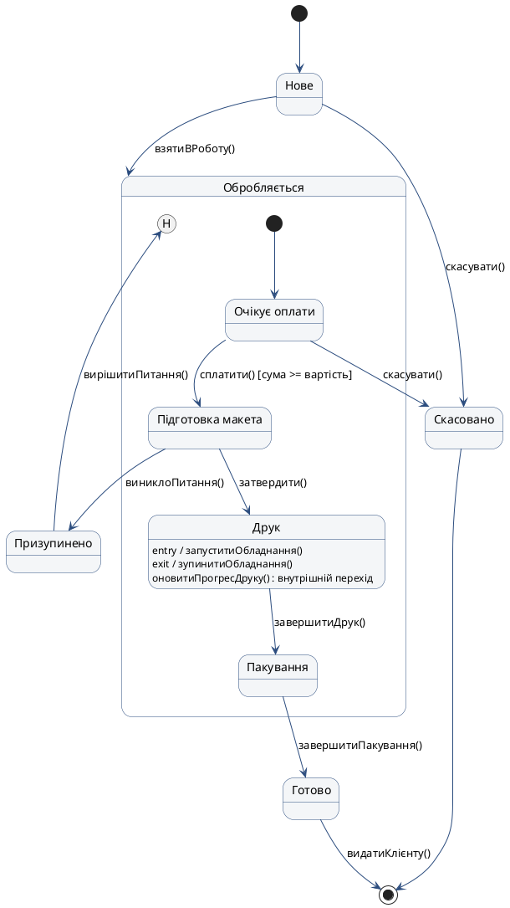

# Лабораторна робота №5
## Побудова діаграми станів об'єкта

**Студентка:** Дашкевич Вікторія (група ВТ-23-1)  
**Дисципліна:** Моделювання та аналіз програмного забезпечення  

---

### 1. Обґрунтування вибору класу
Для побудови діаграми станів було обрано клас **`Замовлення`** (з діаграми класів Лабораторної роботи №2). 
Життєвий цикл замовлення у системі диспетчеризації друкарні («Друкар») є нелінійним і передбачає складну поведінку: розгалуження на етапі перевірки макета, можливість тимчасового призупинення процесу за запитом, а також чіткі обмеження на скасування залежно від поточного стану (наприклад, замовлення не можна скасувати, якщо воно вже перебуває на етапі друку).

---

### 2. Таблиця відбору станів і подій

| Атрибут / Метод класу | Роль у діаграмі станів |
| :--- | :--- |
| `currentStatus: String` | Визначає базові стани об'єкта: `Нове`, `Обробляється`, `Готово`, `Скасовано`. |
| `взятиВРоботу()` | Подія, що переводить замовлення зі стану `Нове` до складеного стану `Обробляється`. |
| `сплатити()` | Подія переходу з охоронною умовою `[сума >= вартість]` для початку підготовки макета. |
| `виниклоПитання()` / `вирішитиПитання()` | Події для переведення замовлення в стан `Призупинено` та повернення через псевдостан історії (`H`). |
| `скасувати()` | Подія дострокового припинення замовлення (доступна лише на початкових етапах). |

---

### 3. Код діаграми станів (PlantUML)

---

### 4. Таблиця станів і переходів

| № | З якого стану | Подія | До якого стану | Коментар |
| :--- | :--- | :--- | :--- | :--- |
| **1** | `[*]` (Початок) | `увійти / створити` | Нове | Ініціалізація об'єкта замовлення |
| **2** | Нове | `взятиВРоботу()` | Обробляється → Очікує оплати | Перехід у складений стан |
| **3** | Нове | `скасувати()` | Скасовано | Скасування до початку обробки |
| **4** | Очікує оплати | `сплатити() [сума >= вартість]` | Підготовка макета | Перехід з охоронною умовою |
| **5** | Очікує оплати | `скасувати()` | Скасовано | Скасування на етапі очікування коштів |
| **6** | Підготовка макета | `затвердити()` | Друк | Перехід до виробничого етапу |
| **7** | Підготовка макета | `виниклоПитання()` | Призупинено | Тимчасова зупинка процесу обробки |
| **8** | Призупинено | `вирішитиПитання()` | Історія (`H`) → Підготовка макета | Повернення через псевдостан історії |
| **9** | Друк | `завершитиДрук()` | Пакування | Перехід після виконання дії `exit` |
| **10** | Пакування | `завершитиПакування()` | Готово | Завершення всіх етапів обробки |
| **11** | Готово | `видатиКлієнту()` | `[*]` (Кінець) | Успішне завершення життєвого циклу |
| **12** | Скасовано | `[*]` | `[*]` (Кінець) | Дострокове завершення (скасування) |

---

### 5. Таблиця проходження для двох послідовностей подій

**Послідовність А (успішне виконання без зупинок):**  
`взятиВРоботу()` $\rightarrow$ `сплатити()` $\rightarrow$ `затвердити()` $\rightarrow$ `завершитиДрук()` $\rightarrow$ `завершитиПакування()` $\rightarrow$ `видатиКлієнту()`

| Крок | Подія | Стан об'єкта після події |
| :---: | :--- | :--- |
| **0** | — | Нове |
| **1** | `взятиВРоботу()` | Обробляється / Очікує оплати |
| **2** | `сплатити()` | Обробляється / Підготовка макета |
| **3** | `затвердити()` | Обробляється / Друк (виконується `entry`) |
| **4** | `завершитиДрук()` | Обробляється / Пакування (виконується `exit`) |
| **5** | `завершитиПакування()` | Готово |
| **6** | `видатиКлієнту()` | `[*]` (Кінець) |

**Послідовність Б (з тимчасовим призупиненням через питання до макета):**  
`взятиВРоботу()` $\rightarrow$ `сплатити()` $\rightarrow$ `виниклоПитання()` $\rightarrow$ `вирішитиПитання()` $\rightarrow$ `затвердити()`

| Крок | Подія | Стан об'єкта після події |
| :---: | :--- | :--- |
| **0** | — | Нове |
| **1** | `взятиВРоботу()` | Обробляється / Очікує оплати |
| **2** | `сплатити()` | Обробляється / Підготовка макета |
| **3** | `виниклоПитання()` | Призупинено |
| **4** | `вирішитиПитання()` | Обробляється / Підготовка макета (через `H`) |
| **5** | `затвердити()` | Обробляється / Друк |

---

### 6. Пояснення навмисно відсутнього переходу
На діаграмі **навмисно відсутній** перехід події `скасувати()` із підстанів `Друк` та `Пакування`.  
* **Бізнес-правило:** Клієнт або менеджер не може скасувати замовлення після того, як воно вже запущене у фізичне виробництво (надруковане чи виготовлене), оскільки витрачено матеріальні ресурси друкарні. Структурна відсутність стрілки унеможливлює такий перехід на рівні логіки моделі.

---

### 7. Висновк
Протягом виконання лабораторної роботи ми закріпили матеріал лекції 8 і навчилися будувати діаграму станів для одного з класів власного курсового завдання: виражили життєвий цикл об'єкта через прості й складені стани, застосовували псевдостан історії, дії входу й виходу, внутрішні переходи та переходи з охоронними умовами, а також свідомо кодували бізнес-правила самою структурою діаграми — відсутністю певних переходів там, де вони дійсно неможливі.