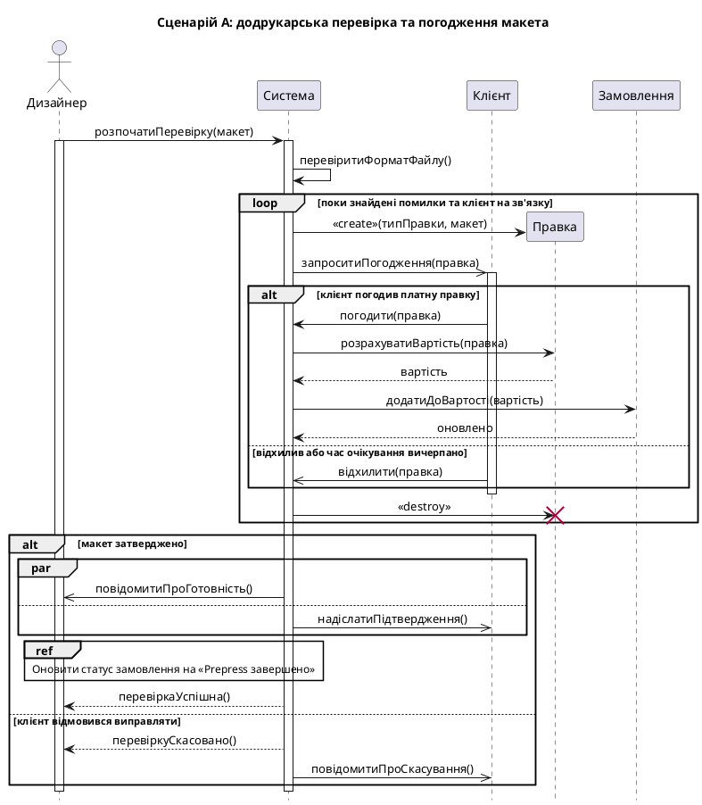
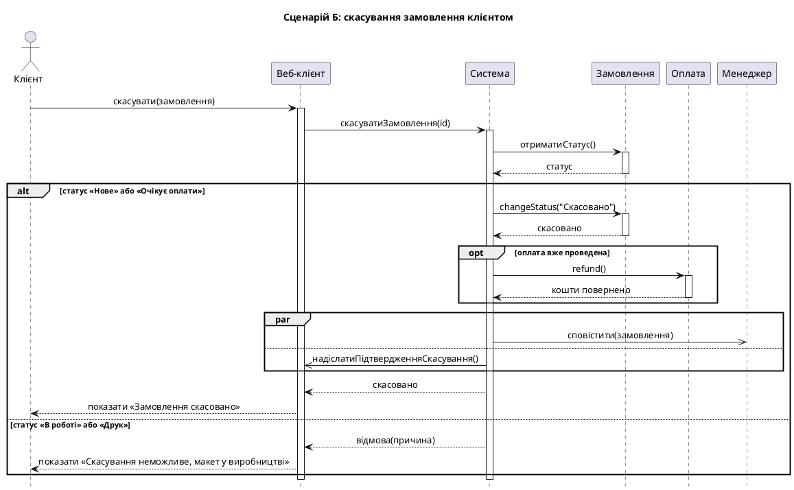

# Лабораторна робота №6

**Мета роботи: закріпити на практиці матеріал лекції 9 і навчитися будувати діаграми послідовності (Sequence Diagram) мови UML (Unified Modeling Language — уніфікована мова моделювання) для двох–трьох ключових сценаріїв власного курсового завдання: показувати, які об'єкти беруть участь у сценарії, у якому порядку вони обмінюються повідомленнями, застосовувати комбіновані фрагменти для розгалужень, циклів і паралельності, а також перевіряти, що побудована взаємодія узгоджена зі структурною моделлю (діаграмою класів) та поведінковою моделлю життєвого циклу об'єкта (діаграмою станів).**

1\. Обґрунтування вибору сценаріїв

**Сценарій А: "Додрукарська перевірка та погодження макета"**. Цей сценарій обрано, оскільки він ідеально демонструє циклічність процесу (пошук та виправлення помилок), а також вимагає створення та знищення тимчасового об'єкта (конкретної технічної `Правки`).

**Сценарій Б: "Скасування замовлення клієнтом"**. Сценарій обрано для демонстрації розгалуження поведінки залежно від внутрішнього стану об'єкта (`Замовлення`), а також для показу необов'язкових дій (повернення коштів) і паралельного сповіщення учасників.

##### 2\. Відбір учасників і повідомлень

|Крок|Сценарій А: Додрукарська перевірка|Сценарій Б: Скасування замовлення|
|-|-|-|
|**1-2. Ініціатор і межі**|Ініціатор — Дизайнер. Завершення — макет затверджено або перевірку скасовано.|Ініціатор — Клієнт. Завершення — замовлення скасовано (з поверненням коштів) або відмова.|
|**3. Учасники**|Дизайнер, Система, Клієнт, Правка, Замовлення.|Клієнт, Веб-клієнт, Система, Замовлення, Оплата, Менеджер.|
|**5. Фрагменти**|`loop` (перебір помилок), `alt` (погодження правки; фінальне затвердження), `par` (сповіщення).|`alt` (перевірка статусу), `opt` (повернення коштів), `par` (сповіщення Менеджера та Веб-клієнта).|
|**6. Тимчасові об'єкти**|**Правка** — створюється для кожної знайденої помилки і знищується.|Тимчасових об'єктів немає.|

#### 

#### 3\. Діаграми послідовності

###### Сценарій А: додрукарська перевірка та погодження макета

**Як читати діаграму:**
Актор Дизайнер синхронно викликає Систему, щоб розпочати перевірку макета. Система робить самовиклик для базової перевірки формату файлу. Далі відкривається цикл (`loop`), який триває, поки в макеті є помилки. Усередині циклу Система створює тимчасовий об'єкт `Правка` (`<<create>>`) та асинхронно запитує погодження у Клієнта. Вкладений фрагмент `alt` розрізняє дві ситуації: якщо Клієнт погоджує правку, Система просить об'єкт `Правка` розрахувати вартість, після чого синхронно оновлює загальну суму в об'єкті `Замовлення`. Якщо Клієнт відхиляє правку — Система фіксує відмову. Наприкінці кожної ітерації циклу об'єкт `Правка` знищується (`<<destroy>>`), оскільки його життєвий цикл обмежений одним запитом. Після завершення перевірок зовнішній фрагмент `alt` визначає фінальний результат: якщо макет затверджено, паралельно (`par`) сповіщаються Дизайнер і Клієнт, статус замовлення оновлюється через винесене посилання (`ref`), а Дизайнер отримує підтвердження. Якщо ж Клієнт відмовився виправляти критичні помилки, перевірка скасовується.

###### Сценарій Б: скасування замовлення клієнтом

**Як читати діаграму:**
Клієнт ініціює скасування замовлення через Веб-клієнт, який передає запит до Системи. Система синхронно звертається до об'єкта `Замовлення`, щоб отримати його поточний статус. Фрагмент `alt` кодує жорстке бізнес-правило друкарні: скасування можливе лише для статусів «Нове» або «Очікує оплати». Якщо ця умова виконується, Система змінює статус `Замовлення` на «Скасовано». Усередині успішної гілки застосовано необов'язковий блок `opt`: повернення коштів (`refund()`) через об'єкт `Оплата` виконується виключно за умови, що платіж уже був проведений. Далі паралельно (`par`) розсилаються незалежні асинхронні сповіщення Менеджеру та Веб-клієнту. Наприкінці Веб-клієнт показує користувачеві повідомлення про успішне скасування. Якщо ж статус замовлення «В роботі» або «Друк» (гілка `else`), Система повертає відмову, і Клієнт бачить повідомлення про неможливість скасування через те, що макет уже передано у виробництво.

#### 4\. Таблиця простежуваності до діаграми класів (Лаб. №2)

|Повідомлення на діаграмі|Отримувач|Метод у діаграмі класів Лаб. №2|Висновок|
|-|-|-|-|
|`calculatePrice()`|Правка|`Правка.calculatePrice(isWholesale): double`|**Є, збігається.**|
|`changeStatus("Скасовано")`|Замовлення|`Замовлення.changeStatus(newStatus: String): void`|**Є, збігається.**|
|`refund()`|Оплата|`Оплата.refund(): void`|**Є, збігається.**|
|`додатиДоВартості()`|Замовлення|Метод відсутній|**Потребує додавання:** `+ updatePrice(addedValue: double): void`|
|`отриматиСтатус()`|Замовлення|Метод відсутній (є лише атрибут `currentStatus`)|**Потребує додавання:** `+ getStatus(): String`|
|`розпочатиПеревірку()`, `скасуватиЗамовлення()`|Система|Клас `Система` відсутній|**Потребує додавання нового керівного класу** (Control class), який координує бізнес-логіку друкарні.|
|`<<create>>(типПравки)`|Правка|-|**Узгоджено.** Це створення екземпляра існуючого класу, асоційованого з макетом (композиція з Лаб. 2).|

#### 5\. Звірка з діаграмою станів (Лаб. №5)

(Перевірка життєвого циклу об'єкта `Замовлення` зі Сценарію Б)

|Подія в діаграмі послідовності|Подія / перехід у діаграмі станів Лаб. №5|Висновок|
|-|-|-|
|Клієнт викликає `скасувати()` для статусів «Нове» або «Очікує оплати»|`скасовано клієнтом()` $\\rightarrow$ перехід до «Скасовано»|**Узгоджено.** Діаграма станів дозволяє такий перехід на ранніх етапах.|
|Виклик `refund()` при скасуванні|Дію `повернення коштів()` описано на переході в стан «Скасовано»|**Узгоджено.**|
|Спроба скасування для статусів «В роботі» або «Друк» (гілка `else`)|Перехід у стан «Скасовано» з виробничих станів відсутній|**Узгоджено.** Діаграма станів забороняє такий перехід, що підтверджується логікою `alt`.|

#### 6\. Перевірка відповідності вимогам завдання

|Вимога|Де виконано|
|-|-|
|**≥ 3 лінії життя, є актор**|Сценарій А: 5 ліній (актор Дизайнер). Сценарій Б: 6 ліній (актор Клієнт).|
|**Синхронні/асинхронні повідомлення, повернення**|А: `запроситиПогодження` (асинхр.), `розрахуватиВартість` (синхр.) + повернення `вартість`.|
|**Самовиклик**|А: `перевіритиФорматФайлу()` викликається самою Системою.|
|**Створення та знищення**|А: Тимчасовий об'єкт `Правка` (використано `<<create>>` та `<<destroy>>` з хрестиком).|
|**alt, opt, loop, par**|А: `loop`, `alt`, `par`. Б: `alt`, `opt`, `par`.|
|**Посилання ref**|А: `ref over D, S : Оновити статус замовлення...`|
|**Активації**|Відображено для всіх об'єктів під час виконання роботи (блоки `activate`/`deactivate`).|

#### 7\. Протокол використання ШІ

* **Запит:** Вибір релевантних сценаріїв для архітектури друкарні (МАПЗ), перетворення текстової логіки на чернетку PlantUML.
* **Запропоновано моделлю:** Початковий код з лінійною логікою та базовими операторами (`alt`, `loop`).
* **Коригування:** Структуру коду, відступи та нотацію було власноруч адаптовано під строгі вимоги та еталонний приклад з методичних вказівок викладача (додано команду `hide footbox` для прибирання зайвих дублювань, виправлено назви методів відповідно до Лабораторної №2, перевірено логіку переходу станів для Лабораторної №5).

#### Висновок

Протягом виконання лабораторної роботи було успішно побудовано діаграми послідовності для двох ключових сценаріїв системи диспетчеризації друкарні. Взаємодію об'єктів змодельовано із застосуванням комбінованих фрагментів (`alt`, `opt`, `loop`, `par`) та візуалізацією життєвого циклу тимчасових сутностей (об'єкт `Правка`).

